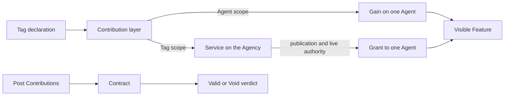

# Features: what an Agent gains and an Agency serves

> **Proposal — STEP-SPEC-58 is a Brief.** This page records vocabulary and
> a deletion design under review. It does not describe deployed deletion
> behavior. In particular, the examples containing `del agent.name` are
> design examples, not code promised to run in the current TopKit release.

TOP needs two views of the same program. An author asks what an Agent or an
Agency exposes. The Overlay engine asks which declaration supplied each
layer. **Feature** is the author-facing word; **Contribution** remains the
composition word.

## Six words

| Word | Meaning |
| --- | --- |
| **Feature** | A named capability, value, check, or shared facility exposed by an Agent or Agency. |
| **Contribution** | A declaration layer that supplies, replaces, deletes, or composes a Feature in the Overlay. |
| **Gain** | A Feature owned by one Agent and given by a Tag: an Action, Record, Tool-marked Record value, or Agent Post check. |
| **Service** | A Feature owned at Tag/Agency scope: a Report or Operation. |
| **Grant** | One Agent's authorized route to a published Service. The Agent receives access, not a copy of the Service. |
| **Contract** | The visible Overlay of Post checks that determines the Agent's validity. |

The terms name different questions. A Report is both a Contribution kind and
a Service. Its `@Public` adapter gives each eligible member a Grant. An Action
is a Contribution kind and, once applied to one Agent, a Gain. Several
Contributions can build one visible Feature at the same name.



## Gain and Service answer ownership

An Action or Record is received by one Agent. That Agent owns the resulting
Gain even though its Contribution was declared inside a Tag class.

A Report or Operation has the Tag as receiver. The Agency owns that Service
at Tag scope. Publication does not move or copy it onto every Agent;
publication gives each eligible member a Grant to reach it.

The short reading is:

> A Tag gives an Agent a **Gain**. An Agency owns a **Service**. Publication
> gives a member a **Grant** to that Service.

This is why an Agent leaving an Agency can keep an ordinary Action Gain while
losing access to a published Operation Service. The two Features have
different owners.

## Contract answers validity

Posts compose the Contract. When every visible Post holds, including when
there are no Posts, the Agent has a **Valid Contract**. If one or more visible
Posts fail, it has a **Void Contract**.

- A free Agent with a Valid Contract is a **Valid Agent**.
- A free Agent with a Void Contract is a **Broken Agent**.
- An **arrested Agent** is in a Safehouse while Rip work remains. Arrest is a
  separate cleanup status, so the Agent is neither Valid nor Broken until the
  saved work succeeds.

The implementation and older documents also use *sound* and *defective* for
the first two population states. STEP-SPEC-58 proposes Valid and Broken as
the author-facing terms; it does not change the current set algebra by
renaming them.

A Precondition is a Gate protocol. It judges a Target before the Tag gives
that Target its Features, so the Precondition is not itself a Feature handed
to the Target. The public `Contract` namespace can continue to expose Gate
diagnostics for compatibility even though validity comes from the Post
Overlay.

## Presence asks for a Feature, not its implementation kind

`"name" @ agent`, read “name at agent”, asks whether the Agent currently has
that named Feature. The answer need not say whether its visible Contribution
is an Action, Record, published Report, or published Operation. Value,
callability, permission, and Contract validity remain separate questions.

This keeps the existing Presence rule precise:

```text
"dispatch" @ ari     # Is the Feature present at Ari?
ari in Agency        # Is Ari a Valid member of this Agency?
bool(ari)             # Does Ari have a Valid Contract?
```

## Proposed Agent deletion

STEP-SPEC-58 proposes one linguistic act at Agent scope:

```text
del ari.spellbook     # end Ari's Gain at this name
del ari.dispatch      # revoke Ari's Grant; keep Agency.dispatch
```

The proposal does not make `del ari.dispatch` delete the shared Operation.
The Agency still owns its Service and another member keeps a separate Grant.
Tag-scope deletion, such as deleting a Report from its Tag, remains a
different act.

The exact Overlay boundary, Constant behavior, saved handles, dunder
Features, missing-Feature result, and Host fallback remain review points in
[STEP-SPEC-58](../steps/spec/STEP-SPEC-58-agent-feature-deletion.md). Until
that STEP is cleared and implemented, follow the current runtime behavior in
the [TopKit Guide](../TopKit/GUIDE.md).
