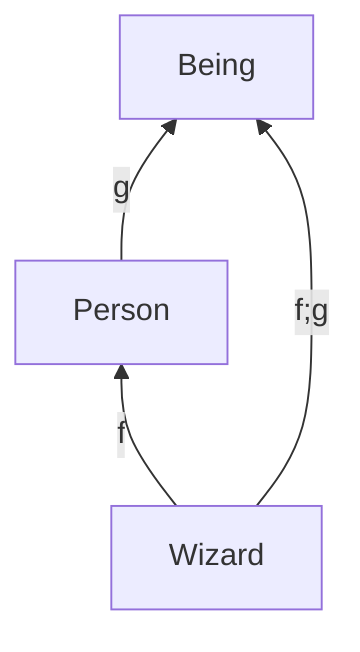
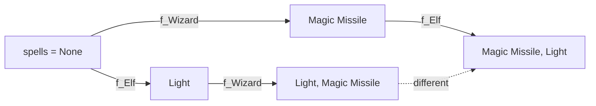
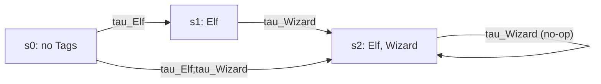

# 2.1 — TOP as a Mathematical System

> Based on the Director's analysis *TOP y teoría de categorías* (15 Oct 2026).
> Every claim marked **(verified)** was re-run against `main` at `30dfe49`
> (20 Oct 2026); the probes live with the test suite's conventions and exit
> clean. Citations like **[Spec §0.5]** point into `spec/SPECIFICATION.md`,
> the source of truth.

Tag-Oriented Programming is not "category theory applied", and does not
pretend to be: the Specification calls itself *"a thinking system: a simple
idea with analogies to the real world"*. But four of its load-bearing parts
are genuine mathematical structures, and where the analogy fails, it fails
because TOP **chose** otherwise — on the record. This chapter names the
structures, the choices, and the laws that can be (and in part already are)
tested.

---

## 1. Category theory in one page

A **category** has objects; arrows between objects (an arrow `f : A → B`
has a *domain* `A` and a *codomain* `B`); a **composition** `f ; g : A → C`
that exists exactly when `f`'s codomain is `g`'s domain; and an **identity**
arrow on every object. Two axioms, nothing more:

- *associativity*: `(f ; g) ; h = f ; (g ; h)`
- *identity*: `id ; f = f = f ; id`

We write `f ; g` in diagram order — first `f`, then `g` — because that is
how a TOP program reads: `Elf(ari); Wizard(ari)`.

Special cases this chapter uses:

| Category | Objects | Arrows | Note |
| --- | --- | --- | --- |
| **Preorder** | elements | one arrow `a → b` iff `a ≤ b` | composition is transitivity; identity is reflexivity |
| **Monoid** | one object | the monoid's elements | composition is the operation; identity is the neutral element |
| **Set** | sets | functions | the familiar one |
| **Mat** | dimensions | an *m×n* matrix is an arrow `n → m` | the size check *is* the domain check |

A **product** of `A` and `B` is an object `A × B` with projections to each,
*universal*: anything else that reaches both `A` and `B` factors through it
in exactly one way. In a preorder, the product is the **meet** (greatest
lower bound) and the coproduct is the **join**. A **functor** maps objects
to objects and arrows to arrows, preserving composition and identities;
between preorders, a functor is just a **monotone function**.

The test for every correspondence below: **an analogy is a category only if
the two axioms hold**, and a "functor" only if it preserves composition.
Otherwise it is a metaphor, and this chapter calls it one.

---

## 2. The four structures that hold

### 2.1 The Geometry is a partial order **(verified)**

Objects: Tags. One arrow `S → B` exactly when `B` appears in `Form(S)`
**[Spec §0.2]**.

- Identity: the Form *"ends with the Tag itself"*, so `T → T`. ✔
- Composition: the Form is a *Base-first closure*; if `B ∈ Form(S)` and
  `A ∈ Form(B)` then `A ∈ Form(S)` — transitivity. ✔
- Python refuses class cycles, so the preorder is antisymmetric: a
  **poset**.

The triangle commutes: `f;g` is the one arrow `Wizard → Being` that the
Form's transitivity provides. One caution: the Form is also a *total
order* of that closure ("deepest first, in declaration order"). The order
of application is **not** information the poset carries — it belongs to
the Tagging sequence (§2.4 below).

### 2.2 The layers of one name form a monoid of endofunctions **(verified)**

Fix a name — `Attack`, `spells`. Every Tag contributing to that name is a
function from "what was there" to "what is there now":

| Declaration | Function on the slot |
| --- | --- |
| Action with `@Underlay` | `f(u)` — uses the prior layer |
| Action without Underlay | constant — ignores and replaces |
| Record with a stored seat | `f(stored) = merge(stored, …)` |
| Record without one | constant — replaces |
| `@Delete` | `f(u) = ∅` |

The visible Overlay after applying `T₁ … Tₖ` is the composition
`host ; f_{T₁} ; … ; f_{Tₖ}` — **literally the order of the program's
lines**.

- Associative: it is function composition. ✔
- Neutral element: the layer `return u()` / `return stored`. ✔
- **Not commutative** **(verified)**: `Elf;Wizard` yields
  `['Light', 'Magic Missile']`, `Wizard;Elf` yields the reverse.
- Constants are left-absorbing — a layer without Underlay destroys the
  information below it. That is exactly why the kit **diagnoses** it
  (Overwrite Warning, **[Spec §1.2–1.3]**): it is the only layer that
  throws information away.
- Early capture makes this real composition: the Underlay *"never
  resolves again later"*, so each `f_T` composes with a fixed value.

Where it is less clean: a builder may read *other* names and the call's
inputs, so `f_T` is really a function of the whole state; `@Constant`
refuses later layers (composition becomes partial); and an Action and a
Record of independent Tags may not share a name **[Spec §1.1]**.

### 2.3 Populations form a lattice — at one instant, as sets **(verified)**

Objects: populations (sets of Agents) at a fixed instant; arrows:
inclusions. Then:

- `Wizard & Fighter` is the intersection — the **meet**, i.e. the
  categorical **product** in this poset. ✔
- `Wizard | Fighter` is the union — the **coproduct**. ✔
- `Wizard - Sworn` is relative difference. ✔
- There is **no complement**: *"`~(Wizard | Fighter)` has no universe to
  complement"* (`TopKit/FIELDS.md` §5). A distributive lattice with
  relative difference and no complement is a **generalized Boolean
  algebra** — this matches the design; it is not an oversight.
- `~` is not negation. It is "the broken part": idempotent like a
  projector (`~~X == ~X`), and `Wizard` with `~Wizard` partitions
  `Wizard[:]` **(verified — 20/20 set-level lattice checks pass on
  main, including both distributivity laws and absorption)**.

Three honest caveats: the laws hold *as sets* (as sequences, `|` keeps
left-side order first); views are lazy and live, so the lattice is
per-instant; and since the sound-membership ruling (PR #216), plain
`Wizard` reads the **sound** members while `Wizard[:]` reads them all.

**Is "Tag ↦ its Field" a functor from the Geometry to populations?**
For current membership (`in`): **no** — ripping a Base does not remove
the Agent from an active Shape's Field (STEP-SPEC-26), so the map is not
monotone. For history (`isinstance`): **yes** **(verified — the oracle
asserts it after every transition)**. Category theory names the design
decision precisely here: TOP *deliberately* breaks the monotonicity of
`in` so that each membership stands alone.

### 2.4 Tagging is an arrow with effects — a Kleisli category **(verified, with boundaries)**

Fix an Agent and let Σ be its possible states. Each call `T(agent)` is a
transformation `τ_T` of Σ. Composition of calls is function composition
(associative, with "do nothing" as identity), so program order is arrow
composition. Three properties make it a monoid with teeth:

- **Idempotent**: reapplying an active Tag does nothing **[Spec §0.5]**
  — `τ_T ; τ_T = τ_T`, a projector.
- **Not commutative**: see §2.2.
- **Domains matter, like matrix sizes**: `War_Caster(bo)` on a non-Wizard
  fails — the Gate is the type check of the arrow. **(verified; one
  precision: when both the Underlay and the Precondition are unmet, the
  declaration check surfaces first, so the error is a Resolution
  Failure, not a Precondition Failure — [Spec §0.6] step 1 checks
  declarations against the Overlay, then Preconditions.)**

Where the pure-function picture needs correcting, TOP's own laws say how:

1. **Failures keep their effects.** A failure in Gainings or Imprints
   *"raises and preserves acquired Gains"* **[Spec §0.6]**. So an arrow
   is `σ ↦ (σ′, ok | error)` — a **Kleisli arrow** for
   exception-over-state (in Haskell terms `ExceptT e (State s)`, not
   `StateT s (Either e)`, which would lose the state on error and is
   *not* what TOP does).
2. **Rip is not an inverse.** Contributions are sticky and history
   remains; re-applying after a Rip duplicates accumulated Records
   **(verified)**. No groupoid here, by design: *"Rip ends active
   membership without pretending history never happened."*
3. **A call does not decompose into its steps.** `Shape(a)` checks the
   Posts **once, after the whole Form**, *"so a Base may promise what its
   Shape delivers"* **[Spec §0.6, §2.4]**. Therefore
   `Shape(a) ≠ Base(a); Shape(a)` — the right side can raise a
   Postcondition Failure the left side never sees **(verified)**. A call
   is an atomic unit of judgement, like a transaction.

---

## 3. The four analogies that fail — and why that is deliberate

| Candidate | Why it fails | The choice behind it |
| --- | --- | --- |
| "Shape with several Bases = product" | `Arcane_Duelist(Spellcaster, Duelist)` is *a* lower bound, not *the* universal one: `Battle_Mage(Spellcaster, Duelist)` sits under both without factoring through it | TOP is **nominal**: the name counts. The true product lives in populations (`&`) |
| Forgetful functor "Agent → plain object" | trivial on objects (stable identity: the Agent *is* the host) but behaviour is not preserved — a Tag may replace a host method | composition is allowed to change behaviour; only identity is sacred |
| "Dispatch = natural transformation" | there are no two functors for it to connect; name resolution is evaluation of §2.2's composition, and published members check membership and soundness per use | access is state-dependent by design (sound members answer) |
| "Pins = a 2-category" | a 2-category needs arrows between arrows; a Pin is **the same structure one level up** (its Field holds Tags; Records land as Reports, Actions as Operations) | levels repeat, never mix: *"Fields never mix Agents and Tags"* **[Spec §1.9]** |

The signals-and-systems reading (the Director's §6) is worth keeping in
mind as intuition: an Underlay is **feed-forward** (a captured, fixed
input), while an Action calling `agent.X()` is **feedback** — resolved at
play time against whatever layers exist then, a closed loop with the
surprises of late binding. Only the first is pure composition; feedback
corresponds to a *trace*, which carries extra laws of its own.

---

## 4. The testable algebra

The six law families of the Director's notes, re-verified on `main`
`30dfe49` and mapped to today's suite:

| # | Law | On main | In the suite |
| --- | --- | --- | --- |
| 1 | Idempotence: `T(a); T(a)` ≡ `T(a)` | holds | tested (kernel, efficiency, oracle walk) |
| 2 | Call-grouping: any split of a Form gives the same observables — **except** Posts make calls atomic | holds | **not tested as a law** |
| 3 | Prefix views: `Tk[a]` behaves like a fresh agent given `T₁…Tk` | holds **with two carve-outs**: external Imprint effects, and Action *bodies* read the live Agent (the view fixes which layer answers, not what it reads) | carve-out tested; law not |
| 4 | History monotonicity: `isinstance(a, S)` and `B ∈ Form(S)` ⇒ `isinstance(a, B)` | holds | oracle asserts after every transition |
| 5 | Population lattice: commutativity, associativity, absorption, distributivity, `~~X == ~X`, partition | holds (20/20) | pairwise via oracle; **nested expressions untested** |
| 6 | Conditional commutativity: Tags sharing no names (and reading none) commute | holds on probes | **untested; not yet a Spec law** |

Law 6 is the one worth a ruling: *"if two Tags share no names, their order
does not matter"* would make the independent part of TOP a **symmetric
monoidal product** — and gives programmers a crisp design rule.

## 5. Design rules this analysis pays for

1. **A layer without an Underlay is a constant and destroys information.**
   The kit already warns; the algebra says why this is *the* dangerous case.
2. **Keep structure and condition apart.** "Is a" belongs to the Geometry
   (poset arrows); "needs" belongs to Preconditions (an arrow's domain).
   In the Ari example, Elf, Wizard and War_Caster are *independent* in the
   Geometry; "War_Caster needs Wizard" is a domain restriction, not an
   arrow.
3. **Prefer lawful merges.** If a Record's merge is associative with a
   neutral element (a monoid — `stored + new` on lists is), the
   accumulated value does not depend on how calls are grouped; if it is
   also commutative (`max`, set union), Tag order stops mattering for that
   slot.
4. **Say out loud that `Shape(a)` is not `Base(a); Shape(a)`.** It is the
   least intuitive consequence of Posts-once-per-call, and it deserves its
   own sentence in §0.6 and the Contracts guide.

## 6. Open questions on the record

1. A cascading-Rip variant (make `in` monotone downward) — **decided and
   rejected**: *"Rip never cascades"*; a Shape that needs its Base writes
   `@Pre @Post`.
2. Conditional commutativity as Spec law — open; property test first.
3. A structural product of Tags — known non-goal (TOP stays nominal).
4. Diagnosing feedback loops through later layers (as Overwrite is
   diagnosed) — open; recursion *through Posts* is already refused.
5. Time-indexed populations (a functor from program time to lattices) —
   the oracle already is one in practice: an independent model checked
   after every transition.
